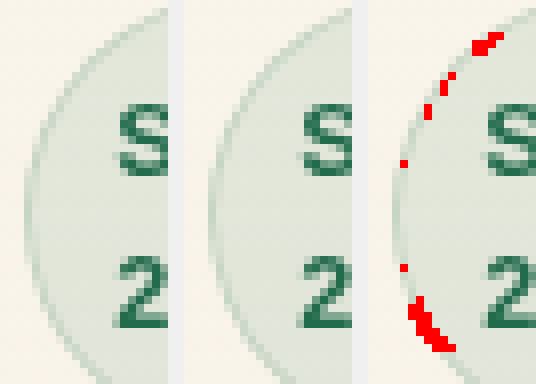

# UBX Shell/Topbar — correção da rasterização Chromium

Investigação de 09/11/2026. PRs [Corporate #1090](https://github.com/rocksbrothers-png/epi-controle/pull/1090) e [SaaS #464](https://github.com/rocksbrothers-png/epi-controle-app/pull/464), ambos em rascunho. Sem autorização de merge/deploy.

## Causa e correção

**B — instabilidade preexistente de renderização, reproduzida localmente.** O fator isolado é o caminho de rasterização parcial/persistente do Chromium 145.0.7632.6. Na topbar mobile, o `backdrop-filter: blur(4px)`, as bordas arredondadas e posições fracionárias produzem pixels variáveis mesmo em repetições da mesma `main`, com DOM, estado, eventos, estilos, geometria e DPR iguais.

O harness passa `--disable-partial-raster` ao Chromium, igualmente para main e branch no mesmo processo. É a única mudança semântica desta correção. As 22 asserções e a comparação PNG byte a byte permanecem idênticas por prova AST. Nenhuma função de produção, CSS, golden, regra de segurança ou idioma mudou. Não há tolerância, retry automático de imagem, sleep ou condição especial de branch.

O [Chromium 145](https://github.com/chromium/chromium/blob/145.0.7632.6/third_party/blink/renderer/platform/widget/compositing/layer_tree_settings.cc#L344) configura `use_partial_raster` por essa opção. O [provedor zero-copy](https://github.com/chromium/chromium/blob/145.0.7632.6/cc/raster/zero_copy_raster_buffer_provider.cc#L118) limita o playback ao retângulo invalidado quando há conteúdo anterior; a [declaração da opção](https://github.com/chromium/chromium/blob/145.0.7632.6/third_party/blink/common/switches.cc#L46) informa também a desativação dos buffers GPU persistentes associados. O experimento isola esse caminho acoplado, sem atribuir o defeito a uma linha/commit interno específico do Skia.

## Matriz e controle de reversão

Cada matriz completa do prefixo usa 5 idiomas × 2 ordens × main/branch × 2 repetições: 40 execuções de 13 passos. Os 40 pares comparam main × main, branch × branch e main × branch em ambas as repetições. Cada execução atravessa desktop 1440×1000 e mobile 390×844, DPR 1, headless e relógio fixo do harness. Os números abaixo são comparações, não percentuais de avanço arquitetural.

| Experimento | Corporate | SaaS |
| --- | --- | --- |
| Host, argumentos originais | 34/40 aprovadas, 6 falhas | 36/40 aprovadas, 4 falhas |
| Ubuntu, argumentos originais | 34/40 aprovadas, 6 falhas | 28/40 aprovadas, 12 falhas |
| Ubuntu original, main × main | 7/10 aprovadas, 3 falhas | 8/10 aprovadas, 2 falhas |
| Ubuntu, sem partial raster | 40/40 aprovadas | 40/40 aprovadas |
| Host, sem partial raster | 40/40 aprovadas | 24/24 comparações completas; tentativa seguinte interrompida antes da captura 13* |
| Host, argumentos originais restaurados | 30/40 aprovadas, 10 falhas; main × main 8/10 | não executado |
| Fluxo completo corrigido, duas rodadas | 220/220 PNGs, 20/20 combinações | 220/220 PNGs, 20/20 combinações |

Cada rodada completa verifica 26 passos na branch e os mesmos 26 na base por combinação: 520 passos observados e 110 comparações PNG; duas rodadas somam 1.040 passos e 220 comparações por produto. A primeira Corporate usou cópia diagnóstica com o mesmo ajuste e import do helper original por caminho explícito; a segunda e ambas SaaS executaram o arquivo do repositório. A matriz DOM/state/events e a referência congelada permaneceram estritas.

*O ensaio SaaS parou na main fr-FR/tenant-before-shell na contagem de PUTs de preferência após repetir scripts/clicar no tema. A tentativa foi preservada como falha e não foi contada como aprovação visual. Dez repetições isoladas dos cinco primeiros passos passaram (5 com argumentos originais, 5 sem partial raster). O dono canônico aplica o tema antes de enviar a preferência assíncrona; uma corrida de observação é hipótese, sem confirmação do contador final naquela tentativa. Nenhuma asserção ou lógica de preferências foi alterada.

Limitar raster threads foi descartado: o modo oficial já informa múltiplas threads desativadas e o ensaio ainda falhou 10/40 comparações. Um rAF não comprovou solução. LayerTree alterou o resultado observado e não foi adotado como sincronização. Remover o backdrop-filter tornou uma amostra de 12 comparações estável, mas foi rejeitado por mudar a apresentação. O replay HTML congelado foi estável e não substituiu o fluxo real.

## Ambiente e pixels

Ubuntu 24.04.5 corresponde ao runner 20261101.360.1 dos logs. Playwright 1.58.0 e ChromeHeadlessShell 145.0.7632.6 foram fixados. Versões de Liberation (2.1.5-3), Fontconfig (2.15.0-1.1ubuntu2), FreeType (2.13.2+dfsg-1ubuntu0.2), Cairo (1.18.0-3build1), Pango (1.52.1+ds-1build1) e GBM (25.2.8-0ubuntu0.24.04.4) coincidem com os logs. Contêiner local usa Python 3.12.3; CI usou 3.11.18. Hardware/kernel, inventário completo de fontes e locale do runner não foram integralmente reproduzidos. No contêiner: TZ=UTC, LANG=C.UTF-8. Não se afirma identidade integral do ambiente.

A análise detalhada cobre 384 capturas 13 das matrizes documentadas (240 Corporate/144 SaaS), com 1.292 linhas de pixels divergentes somadas entre os diferentes pares/experimentos. As falhas do conjunto completo variam entre 16 e 56 pixels, com delta máximo de 7 por canal. Os PNGs são RGB opacos (RGBA decodificado com alfa 255). A transparência do CSS foi composta antes da captura. As diferenças aparecem principalmente nas bordas do chip de data, badge e botão mobile; pontos externos aos retângulos são preservados como `other`. Não são tratados como irrelevantes.

A cena 13 analisada não contém SVG/IMG: os ícones são glifos. Playwright aguarda `document.fonts.ready`; o diagnóstico registrou fontes carregadas, zero animações ativas e estilos/geometria iguais nos pares. Também há diferença em captura da viewport inteira, excluindo uma divergência limitada ao recorte/encoding PNG.

Evidências deste produto: [metadados e resultados](UBX_SHELL_TOPBAR_CHROMIUM_EVIDENCE/evidence.json), [CSV RGBA do controle Ubuntu](UBX_SHELL_TOPBAR_CHROMIUM_EVIDENCE/pixels-rgba.csv), [main](UBX_SHELL_TOPBAR_CHROMIUM_EVIDENCE/main.png), [branch](UBX_SHELL_TOPBAR_CHROMIUM_EVIDENCE/branch.png) e [mapa](UBX_SHELL_TOPBAR_CHROMIUM_EVIDENCE/difference.png). A amostra en-GB/tenant-after-shell tem 43 pixels diferentes. Imagens são reproduções locais Ubuntu, não capturas recuperadas do CI.

## Validação e restrições

| Validação local após o ajuste | Corporate | SaaS |
| --- | --- | --- |
| JavaScript | 699 aprovados | 699 aprovados |
| Python selecionado ampliado | 362 aprovados, 1 warning | 313 aprovados, 1 warning |
| Equivalência Shell/Topbar | 725 sem divergências | 725 sem divergências |
| Mutações | 29/29 detectadas | 29/29 detectadas |
| UBX, build, ESLint do escopo, Ruff do harness, sintaxe app.js | aprovados | aprovados |
| F3, F4/F5B, CSP/segurança e contratos/assets Python | incluídos na seleção aprovada | incluídos na seleção aprovada |
| C3 Chromium na branch/main, cinco idiomas | 0/5 e 4/5; falhas preservadas | 5/5 e 5/5 |
| CSP Chromium, cinco idiomas e negativos | aprovado | aprovado |

C3 é uma restrição separada: Corporate reproduziu na main o mesmo hash de snapshot divergente da branch em pt-BR, ao salvar parâmetros. O conteúdo muda de contrato pendente/histórico preenchido para rascunho/histórico vazio e número diferente. As demais falhas individuais da branch não foram todas reproduzidas nessa amostra da main; há também uma divergência de chamadas comerciais em pt-BR. Não se atribui automaticamente preexistência a cada divergência nem se declara paridade C3 integral. O teste e seus goldens continuam intactos. Não foi alterado código Comercial para aprovar o check. Não há demonstração do alcance em produção a partir destes dados sintéticos.

A correção preserva as 14 funções, as 536 restantes e as diferenças legítimas entre os produtos. Os hashes de todos os arquivos de produção permanecem os dos HEADs iniciais. Python completo, C3, CodeQL e os demais checks da nova execução oficial devem ser consultados no HEAD do PR; aprovações históricas não substituem a nova execução. Este quadro registra resultados locais antes do push, não um parecer de integração.

## Artefatos antigos e autorização de integração

Corporate: run 42408348111/artifact 13589611570 (105478167 bytes). SaaS: run 42408351994/artifact 13589043209 (105143738 bytes). Não expirados. API autenticada HTTP 302; CONNECT recusado pelo proxy com HTTP 403 nos hosts reais `productionresultssa1.blob.core.windows.net` e `productionresultssa4.blob.core.windows.net`.

O conector oficial GitHub recuperou referências dos dois ZIPs. A materialização no executor recusou o Corporate por exceder o limite de 32 MiB; o serviço de arquivos também recebeu CONNECT 403. O conteúdo interno dos ZIPs não foi presumido ou inspecionado. A sessão não oferece ferramenta de alteração de configuração; o usuário informou não ter acesso ao settings e determinou manter ambos os PRs bloqueados enquanto o acesso permanecer indisponível. Nenhuma restrição foi contornada.

**Ambos permanecem BLOQUEADOS para integração**: o resultado de rasterização deve ser confirmado no CI oficial e as restrições de evidência/C3 continuam explícitas. Nenhum merge, deploy ou próxima fatia está autorizado.

## Revisões de origem

| Produto | main | HEAD inicial |
| --- | --- | --- |
| Corporate | `a443e1256473c175f32dcd5b1240a15d96114d4f` | `29ca818dc15cf214337896b5ebe33e1655b3f80b` |
| SaaS | `211c0f56ab663543eccdee281259ac04f77ba9bc` | `fb991ef3ad5c6aaf3a26c68f78f66cf79bae2df6` |
